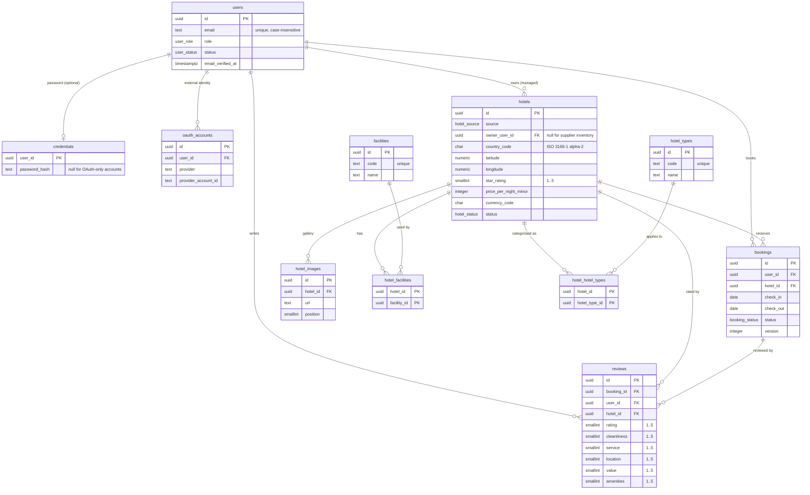

# @hotel-booking/db

PostgreSQL schema, migrations and the typed Drizzle client shared by the API. Migrations are
reviewed SQL under `migrations/`; the schema source of truth is `src/schema/`.

## Commands

```bash
pnpm --filter @hotel-booking/db db:generate   # generate SQL from schema changes
pnpm --filter @hotel-booking/db db:migrate    # apply pending migrations
pnpm --filter @hotel-booking/db db:check      # journal check + schema drift check
pnpm --filter @hotel-booking/db test          # real-PostgreSQL constraint tests
```

`TEST_DATABASE_URL` must point at a disposable PostgreSQL database for the tests. CI applies
migrations before running them; the constraint suite also runs `db:migrate` itself.

## Schema v1 (M1-04)



`bookings` currently carries only identity, ownership and stay dates so reviews can reference a
real row. [M1-05 (#35)](https://github.com/hasnaintypes/hotel-booking-platform/issues/35) adds
guest details, integer minor-unit money, supplier references, snapshots and idempotency;
[M1-16 (#101)](https://github.com/hasnaintypes/hotel-booking-platform/issues/101) adds
organisations, memberships and organisation ownership; [M1-17
(#102)](https://github.com/hasnaintypes/hotel-booking-platform/issues/102) adds currencies and
exchange-rate snapshots and the currency foreign keys.

## Conventions

- **Naming:** plural `snake_case` tables and columns; `*_id` for foreign keys; index and
  constraint names state the table and intent (`reviews_booking_user_unique`).
- **Identifiers:** UUID primary keys. The database default is `gen_random_uuid()` so raw SQL and
  tests work; application code generates sortable UUIDv7, with UUIDv4 as the fallback (ADR-002).
- **Time:** every timestamp is `timestamp with time zone`; `created_at`/`updated_at` default to
  `now()`.
- **Money:** integer minor units plus an explicit ISO-4217 currency code. No floating point
  columns for money. GBP is the only enabled currency until #102 lands.
- **Location:** `country_code` is a two-letter ISO 3166-1 alpha-2 code enforced by a `CHECK`;
  coordinates are bounded by `CHECK` constraints.
- **Soft delete:** users have a `status` (`active`/`suspended`) and hotels have a `status`
  (`draft`/`active`/`inactive`/`archived`). There are no `is_deleted` flags; hard deletion is
  reserved for genuinely disposable rows and uses the explicit `ON DELETE` action on each FK.
- **Foreign keys:** every relationship is a real FK with an explicit `ON DELETE` action. Ownership
  rows use `RESTRICT`; dependent rows (credentials, OAuth accounts, images, joins, reviews) use
  `CASCADE`.
- **Integrity:** case-insensitive unique email, unique OAuth `(provider, provider_account_id)`,
  unique review `(booking_id, user_id)`, rating and category `CHECK`s, non-negative amounts, and
  `check_out > check_in`.
- **No counters:** `totalBookings`, `totalRevenue`, `totalSpent`, `averageRating`, `reviewCount`
  and `occupancyRate` do not exist as columns; reporting computes them in SQL (#41).
- **Extensions:** `pg_trgm` is created by the custom migration `0001_enable_pg_trgm.sql` for the
  hotel city/country trigram indexes. It ships with PostgreSQL contrib and is available on the
  local, CI and Render images.

## Applying changes

1. Edit the relevant file in `src/schema/` and export it from `src/schema/index.ts`.
2. Run `pnpm --filter @hotel-booking/db db:generate` and review the generated SQL.
3. Update `EXPECTED_MIGRATION_COUNT` in `src/migrations.ts` (the manifest test enforces this).
4. Run `db:migrate`, `db:check` and `pnpm --filter @hotel-booking/db test`.
