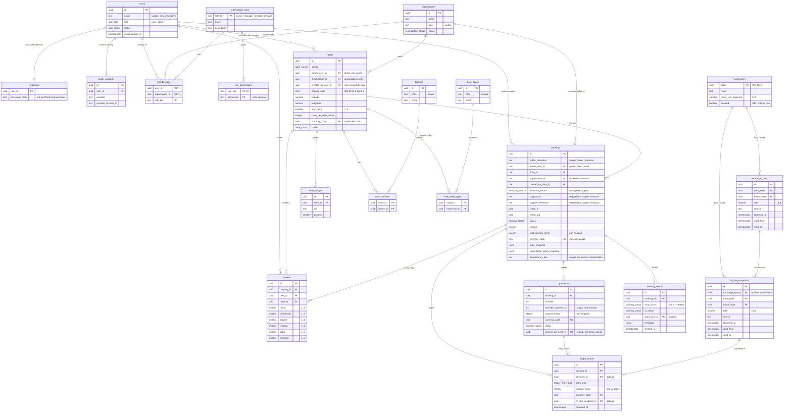

# @hotel-booking/db

PostgreSQL schema, migrations, authorisation helpers and the typed Drizzle client shared by the
API. Migrations are reviewed SQL under `migrations/`; the schema source of truth is
`src/schema/`.

## Commands

```bash
pnpm --filter @hotel-booking/db db:generate   # generate SQL from schema changes
pnpm --filter @hotel-booking/db db:migrate    # apply pending migrations
pnpm --filter @hotel-booking/db db:check      # journal check + schema drift check
pnpm --filter @hotel-booking/db test          # real-PostgreSQL constraint and authz tests
```

`TEST_DATABASE_URL` must point at a disposable PostgreSQL database for the tests. CI applies
migrations before running them; the constraint suite also runs `db:migrate` itself.

`createDb()` sets pool size and statement/idle-transaction/lock timeouts. Use
`withDatabaseTimeouts(db, overrides, run)` when one request needs different limits; the overrides
are scoped to that transaction. Operational procedures live in
[OPERATIONS.md](./OPERATIONS.md).

## Schema (v1 + M1-05 + M1-16)



A managed hotel must have an `owner_user_id`, an `organisation_id`, or both. A booking always has a
guest (`owner_user_id`) and a creator (`created_by_user_id`); `organisation_id` is set when it is
booked on behalf of an organisation. Organisation ownership is optional, so adding an agency booking
does not change the booking shape.

## Currency and exchange rates

- **Reference data:** `currencies.code` is the ISO 4217 code, `minor_unit_exponent` says how many
  decimal places the minor unit has (GBP = 2, JPY = 0), and `enabled` controls whether new money
  may be written in that currency. The migration seeds 20 currencies with GBP as the only enabled
  one; the rest exist so enabling one is configuration rather than a schema change.
- **Money precision:** money is always integer minor units plus a currency code. Exchange rates
  are the only decimal money-related values and use `numeric(18,8)`; no money column is floating
  point. Rounding rules belong with the pricing engine in M2 and will round once at the boundary.
- **Foreign key:** `hotels.currency_code` references `currencies.code`. A database trigger rejects
  inserts or updates that use a currency whose `enabled` flag is false, so a disabled currency
  cannot be used for a new monetary row. Bookings, payments and ledger entries attach the same
  `assert_currency_enabled()` trigger.
- **Rate windows:** an `exchange_rates` row applies when `observed_at <= at`,
  `valid_from <= at`, and `valid_to` is null or after `at`.
- **Lookup:** `lookupExchangeRate(db, { baseCode, quoteCode, at, maxAgeMs })` chooses the latest
  applicable row by `valid_from`, then `observed_at`, then `created_at`. Same-currency lookups
  return the identity rate without a query.
- **Staleness:** `DEFAULT_EXCHANGE_RATE_MAX_AGE_MS` is 24 hours. A rate older than the limit is
  returned as `stale` rather than `found`, so callers must refuse to price a new booking with it.
- **Snapshots:** `fx_rate_snapshots` copies the rate, source and validity window at the moment a
  quote, price snapshot or ledger entry uses it. A database trigger rejects UPDATE, DELETE and
  TRUNCATE, so historical money cannot be rewritten when a rate changes. Quotes, price snapshots
  and ledger entries added in M1-05 reference `fx_rate_snapshots.id` with `ON DELETE RESTRICT`.

## Bookings, payments and ledger

[M1-05 (#35)](https://github.com/hasnaintypes/hotel-booking-platform/issues/35) adds the M2 booking
money model without changing the API yet:

- **Bookings** keep guest details, stay dates and ownership (`owner_user_id`, optional
  `organisation_id`, `created_by_user_id`). `inventory_source` distinguishes managed hotels from
  supplier inventory, and a check constraint requires both supplier fields for supplier rows.
  `public_reference` is a high-entropy guest-facing reference, separate from the UUID primary key.
- **Money** is integer minor units plus `currency_code`; `total_amount_minor`, payment
  `amount_minor` and ledger `amount_minor` all reject negative values. `price_snapshot` and
  `cancellation_policy_snapshot` freeze the quote and policy the guest agreed to.
- **Idempotency** uses partial unique indexes on `(owner_user_id, idempotency_key)` for direct
  bookings and `(organisation_id, idempotency_key)` for agency bookings.
- **Payments** make `(provider, provider_payment_id)` unique across the table, so a replayed
  provider payment cannot create a second booking. A partial unique index permits one active
  primary payment per booking; refunds/corrections are new rows referencing `original_payment_id`.
- **Ledger entries** are append-only charge/refund/fee/adjustment rows (payable and settlement are
  reserved), with an optional FX snapshot. **Booking events** are append-only state history.
  Database triggers reject UPDATE, DELETE and TRUNCATE on both tables with SQLSTATE `55000`.

[M1-17 (#102)](https://github.com/hasnaintypes/hotel-booking-platform/issues/102) supplies the
currency reference data, enabled-currency trigger and immutable `fx_rate_snapshots` used here.

## Authorisation model

Permissions are code constants in `src/authz.ts`; roles and their grants are seeded data in
`organisation_roles` and `role_permissions`.

| Role      | Grants                                                                          |
| --------- | ------------------------------------------------------------------------------- |
| `owner`   | All hotel, booking and organisation permissions, plus membership management.    |
| `manager` | Hotel read/create/update, booking read/create/update/cancel, organisation read. |
| `member`  | Hotel read, booking read/create/update, organisation read.                      |
| `viewer`  | Hotel read, booking read, organisation read.                                    |

A regular user gets access from exactly one of:

- direct ownership — `hotels.owner_user_id` for hotels, `bookings.owner_user_id` for bookings;
- a membership in the resource's own organisation whose role grants the permission;
- the platform `admin` role.

`createAuthorizer(db).can(actor, permission, resource)` is the helper guards and services use.
Memberships in other organisations never apply, and a suspended organisation grants nothing, so
joining an extra organisation cannot widen access. An authenticated user may create their own
booking; creating one for an organisation requires a membership grant such as `booking:create` on
that organisation.

## Conventions

- **Naming:** plural `snake_case` tables and columns; `*_id` for foreign keys; index and
  constraint names state the table and intent (`reviews_booking_user_unique`).
- **Identifiers:** UUID primary keys. The database default is `gen_random_uuid()` so raw SQL and
  tests work; application code generates sortable UUIDv7, with UUIDv4 as the fallback (ADR-002).
- **Time:** every timestamp is `timestamp with time zone`; `created_at`/`updated_at` default to
  `now()`.
- **Money:** integer minor units plus an explicit ISO-4217 currency code. No floating point
  columns for money. `currencies.enabled` makes GBP the only enabled currency for new rows;
  exchange rates use `numeric(18,8)`.
- **Location:** `country_code` is a two-letter ISO 3166-1 alpha-2 code enforced by a `CHECK`;
  coordinates are bounded by `CHECK` constraints.
- **Soft delete:** users have a `status` (`active`/`suspended`), hotels have a `status`
  (`draft`/`active`/`inactive`/`archived`) and organisations have a `status`
  (`active`/`suspended`). There are no `is_deleted` flags; hard deletion is reserved for genuinely
  disposable rows and uses the explicit `ON DELETE` action on each FK.
- **Foreign keys:** every relationship is a real FK with an explicit `ON DELETE` action. Ownership
  rows use `RESTRICT`; dependent rows (credentials, OAuth accounts, images, joins, reviews,
  memberships) use `CASCADE`. A role in use cannot be deleted (`RESTRICT`).
- **Integrity:** case-insensitive unique email, unique OAuth `(provider, provider_account_id)`,
  unique organisation slug, unique membership `(user_id, organisation_id)`, unique review
  `(booking_id, user_id)`, rating and category `CHECK`s, permission vocabulary `CHECK`s,
  non-negative amounts, and `check_out > check_in`.
- **No counters:** `totalBookings`, `totalRevenue`, `totalSpent`, `averageRating`, `reviewCount`
  and `occupancyRate` do not exist as columns; reporting computes them in SQL (#41).
- **Extensions:** `pg_trgm` is created by the custom migration `0001_enable_pg_trgm.sql` for the
  hotel city/country trigram indexes. It ships with PostgreSQL contrib and is available on the
  local, CI and Render images.

## Applying changes

1. Edit the relevant file in `src/schema/` and export it from `src/schema/index.ts`.
2. Run `pnpm --filter @hotel-booking/db db:generate` and review the generated SQL. Backfill new
   `NOT NULL` ownership columns in the migration before adding the constraint.
3. Update `EXPECTED_MIGRATION_COUNT` in `src/migrations.ts` (the manifest test enforces this).
4. Run `db:migrate`, `db:check` and `pnpm --filter @hotel-booking/db test`.
